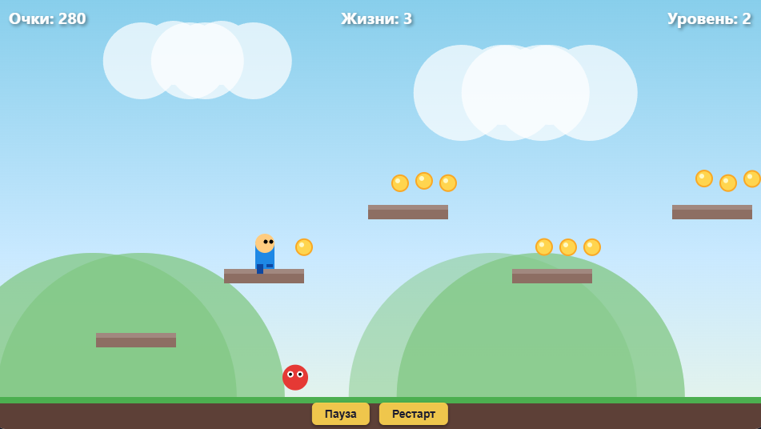

[README.md](https://github.com/user-attachments/files/33822923/README.md)
# Платформер на JavaScript (Canvas API)

## 🎮 Демонстрация
Игра доступна на GitHub Pages: `https://<ваш-username>.github.io/<repo>/`

## 📋 Описание
Аркадный 2D-платформер с двумя уровнями, сбором монет, врагами и системой жизней.

## 🕹️ Управление
| Действие | Клавиши |
|----------|---------|
| Движение | A / D или ← / → |
| Прыжок | Space / W / ↑ |
| Пауза | Кнопка «Пауза» |
| Рестарт | Кнопка «Рестарт» |

## ✨ Функционал
- Управляемый персонаж с плавной анимацией и физикой
- Гравитация, коллизии AABB с платформами (разрешение по вертикали и горизонтали)
- Система очков: +10 за монету, +100 за сбор всех монет, +50 за прохождение уровня
- Система жизней (3), неуязвимость после удара
- Враги с патрулированием
- Два уровня с разной сложностью
- Параллакс-фон (облака и холмы)
- Игровой цикл с фиксированным шагом (fixed timestep) и `requestAnimationFrame`
- HUD: очки, жизни, номер уровня
- Условия победы/поражения

## 🧠 Использование нейросети
- **Нейросеть:** DeepSeek (ChatGPT-совместимая модель)
- **Время выполнения:** ~2–3 часа (генерация + проверка + отладка)
- **Что создано с помощью нейросети:** вся архитектура классов (`Game`, `Player`, `Platform`, `Coin`, `Enemy`, `Collision`, `InputHandler`, `Renderer`), игровой цикл, физика и обработка коллизий, код отрисовки, HTML/CSS, README. Авторская доработка: настройка баланса (скорость, гравитация), компоновка уровней и тестирование.

## 🚀 Запуск
1. Клонируйте репозиторий.
2. Откройте `index.html` в браузере (или запустите локальный сервер: `python -m http.server`).
3. Игра работает без сборки и зависимостей.

## 📁 Структура
index.html
css/style.css
js/
main.js
Game.js
Player.js
Platform.js
Coin.js
Enemy.js
Collision.js
InputHandler.js
Renderer.js

## 🖼️ Скриншоты

## 🛠️ Технологии
- HTML5 Canvas
- Vanilla JavaScript (ES6+)
- CSS3

## 📌 Ключевые технические решения
- **Fixed timestep** (1/120 с) для стабильной физики независимо от FPS.
- **AABB-коллизии** с раздельным разрешением по осям (сначала X, затем Y) — предотвращает «залипание» и проход сквозь платформы.
- **Классовая архитектура** — каждый игровой объект инкапсулирован.
- **Camera smoothing** — плавное следование за игроком.
